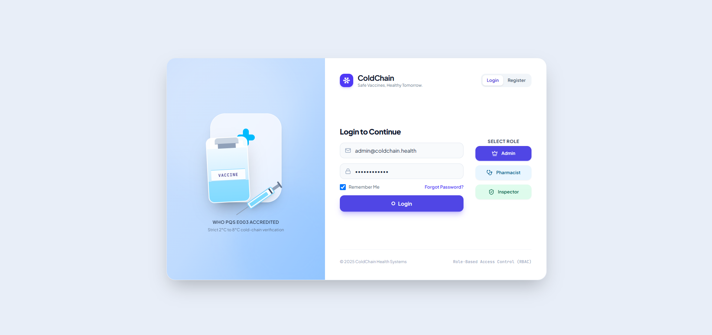
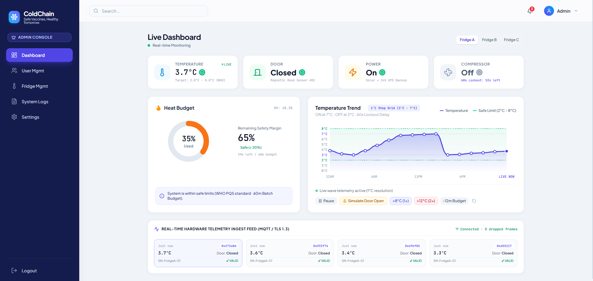
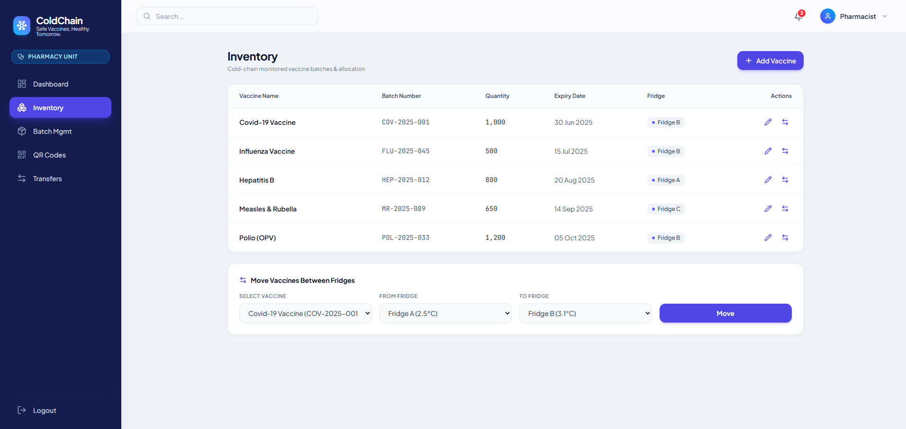

# ❄️ ColdChain — Smart IoT Cold-Chain Management System
--

  

  <b>Intelligent Vaccine Storage Monitoring, Inventory Management & AI-Powered Prediction</b>

  
  
  

---##mithun Modak 

## 📌 About The Project

**ColdChain** is an IoT-based cold-chain monitoring and management web application designed to maintain safe storage conditions for temperature-sensitive products such as vaccines and insulin.

The platform combines real-time monitoring, inventory management, heat-exposure tracking, system alerts, and AI-powered predictive insights in a centralized dashboard.

It provides administrators, pharmacists, and inspectors with a structured environment to monitor fridge conditions, manage vaccine batches, review alerts, and maintain storage records.

## ✨ Core Features

### 🌡️ 1. IoT Fridge Monitoring
- Monitor two refrigerator units using ESP32.
- Track real-time temperature readings.
- Monitor refrigerator door status.
- Display Safe, Warning, and Breach conditions.
- Control compressor operation automatically.
- View temperature information through OLED displays.
- Transmit monitoring data through MQTT.

### 📊 2. Vaccine Heat-Exposure Budget
- Each vaccine batch has a 60-minute heat-exposure budget above 8°C.
- Track cumulative heat exposure.
- Exposure above 12°C counts double.
- Display remaining exposure budget.
- Identify batches as Safe, At Risk, or Discard.
- Red LED indication for discarded batches until admin reset.

### 🔋 3. Power Failure & Offline Monitoring
- Simulated power failure monitoring.
- Battery and power status tracking.
- Offline data buffering during Wi-Fi disconnection.
- Automatic synchronization of stored readings.
- Door-open alerts after 60 seconds.
- Notification support through SMS, Telegram, or email.

### 🖥️ 4. Smart Web Dashboard
- Live temperature monitoring.
- Refrigerator door and power status.
- Compressor status visualization.
- Heat-exposure budget overview.
- System alerts and notifications.
- Modern and responsive user interface.

### 📦 5. Vaccine Inventory Management
- Manage vaccine batches.
- Monitor batch information and expiry dates.
- Assign batches to refrigerators.
- Move batches between refrigerators.
- View batch safety status.

### 👥 6. Authentication & Role Management
- Secure user authentication.
- JWT-based authentication.
- Bcrypt password hashing.
- Three user roles:
  - **Admin:** System and user management.
  - **Pharmacist:** Vaccine inventory and relocation management.
  - **Inspector:** Monitoring and record review.
- Server-side permission enforcement.

### 📱 7. Public QR Verification
- Public access to batch information through QR codes.
- No login required.
- Display vaccine batch safety status.
- Show expiry information.
- Provide quick batch verification.

### 🔐 8. Device Security & Data Integrity
- HMAC-SHA256 message authentication.
- Timestamp and nonce validation.
- Detection of invalid and replayed messages.
- Tamper-evident activity records.
- Hash-chain-based log integrity verification.
- Verify Integrity functionality.

### 🤖 9. AI Breach Prediction & Relocation
- Predict refrigerator temperature 30 minutes ahead.
- Identify potential temperature breaches above 8°C.
- Monitor compressor performance.
- Display compressor health score (0–100).
- Suggest suitable refrigerator relocation options.
- Recommend batches that may need relocation.
- One-click relocation confirmation for pharmacists.
- Generate AI prediction reports with dataset, features, and results.

## 📸 Application Screenshots

  
   
  <i>Login Page</i>

  
   
  <i>Dashboard Overview</i>

  
   
  <i>Vaccine Inventory Management</i>

## 🛠️ Technology & Components

| Component | Technology |
|---|---|
| Microcontroller | ESP32 |
| Temperature Monitoring | Temperature Sensor |
| Communication | MQTT |
| Display | OLED |
| Hardware Control | Relay, LED, Buzzer |
| Authentication | JWT & bcrypt |
| Device Security | HMAC-SHA256 |
| Data Integrity | Hash Chain |
| Web Application | Project-specific frontend & backend technologies |
| AI Module | Temperature Prediction & Performance Analysis |

## Project Objectives

- Maintain safe storage conditions for temperature-sensitive products.
- Improve vaccine storage visibility and monitoring.
- Track heat exposure and batch safety.
- Provide reliable offline monitoring.
- Strengthen device communication security.
- Detect potential storage failures before they occur.
- Support intelligent vaccine relocation decisions.
- Deliver a centralized cold-chain management experience.

## 👨‍💻 Developer

**Sajjadul Islam**

- GitHub: [@sajjadul404](https://github.com/sajjadul404)

  <b>ColdChain — Smart Monitoring | Secure Storage | Safer Vaccines.</b>

  

